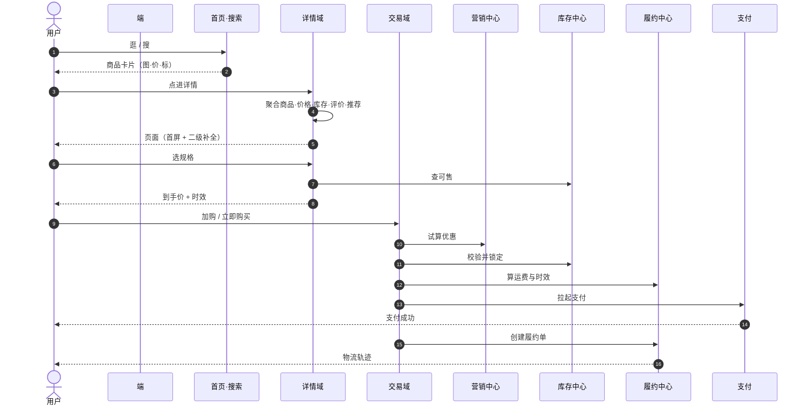
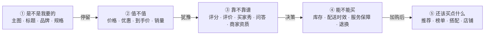
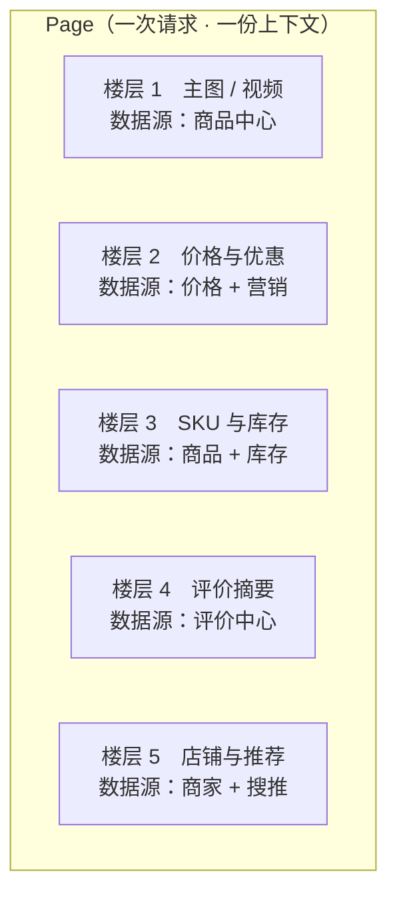
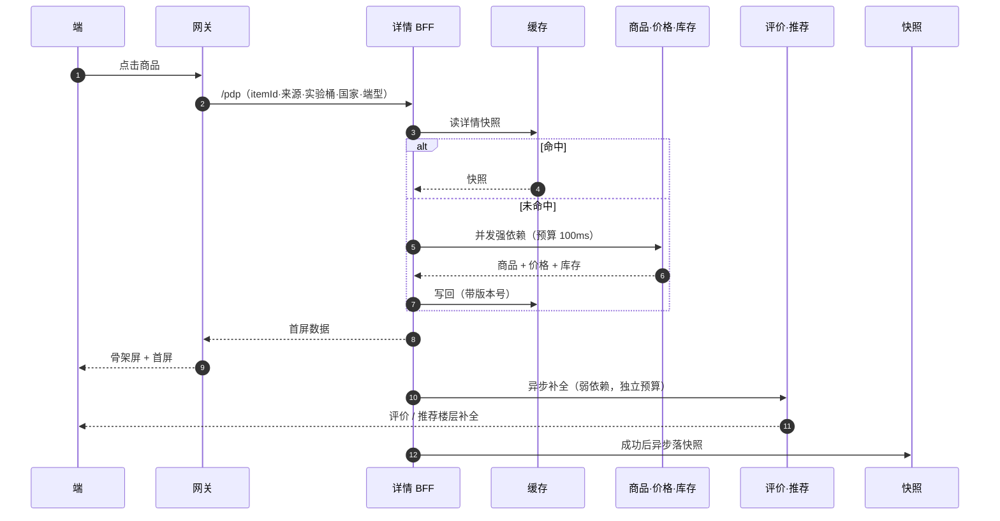
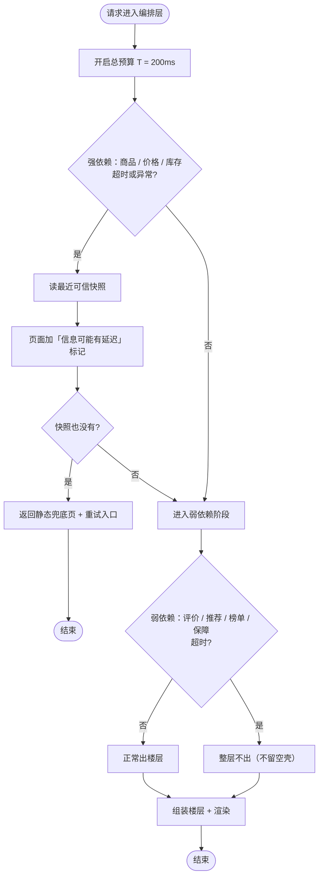
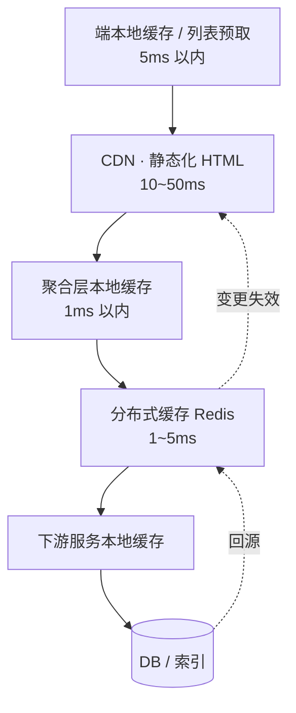
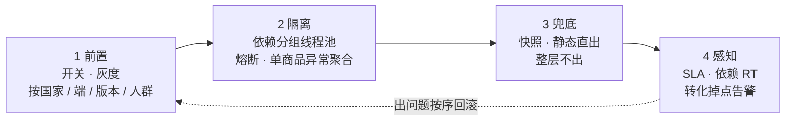
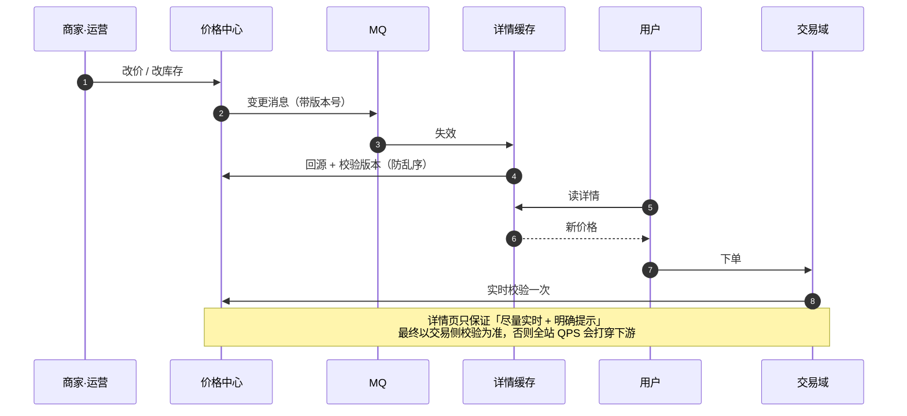
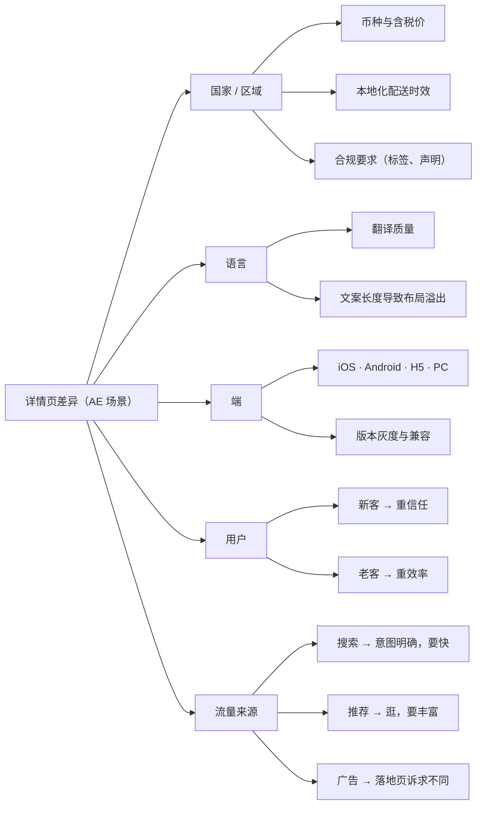

# 电商整体总结 & 思考

> 电商就是在「`人—货—场`」之间修一条最短的路。路上每个系统只干三件事之一：把货找出来、帮人做决定、把货送到手。

---

## 一、全局

### 1.1 用户只有一条主链路

>一句话概括全站指标：**GMV = 流量 × 转化率 × 客单价 × 复购**

四者是相乘关系，任何一环掉 20%，结果就掉 20%。所以详情这种「中间环节」的稳定性优先级天然高于功能迭代——它挂了，前后两端一起白干

### 1.2 全站分层

四层职责，一句话一层：

- **端**：交互、渲染、埋点。不碰业务规则。
- **接入 / BFF**：鉴权、限流、聚合、裁剪、SSR。只做「取数 + 拼装」，不做判断。
- **业务域**：编业务规则，回答「什么流量、什么场景，给什么内容」。
- **核心能力**：只提供数据和原子能力，不关心页面长什么样。

一条原则：**越往下越不关心页面，越往下越要稳。** 底下抖一下，上面全挂。

### 1.3 域职责与边界

| 域         | 负责                                 | 不负责（最容易越界的地方）       |
| ---------- | ------------------------------------ | -------------------------------- |
| 商品中心   | SPU/SKU 主数据、类目、属性、图文详情 | 价格、库存、能不能买             |
| 价格中心   | 基础价、活动价、税费、币种换算       | 谁能看到什么价                   |
| 库存中心   | 可售库存、锁定、扣减                 | 「仅剩 3 件」这类话术            |
| 营销中心   | 优惠规则与试算、券                   | 优惠怎么摆到页面上               |
| 履约中心   | 时效、运费、承运、轨迹               | 商品信息                         |
| 评价中心   | UGC 内容、审核、聚合分               | 怎么排序、怎么表达心智           |
| 搜推引擎   | 候选与排序                           | 页面呈现                         |
| **详情域** | 聚合、编排、表达、兜底               | **不自己生产商品/价格/库存数据** |
| 交易域     | 下单、订单状态、支付                 | 商品信息透出                     |

详情域的「不自己生产数据」这条最关键。一旦开始自己算价格、自己缓存库存做判断，出了问题就没人认账，也没人能从下游把真相捞回来。

### 1.4 一次完整购物

看这张图的重点不是流程，是**每一跳都在把「不确定」变成「确定」**：价格不确定 → 试算确定；库存不确定 → 锁定确定；时效不确定 → 承诺确定。详情页的定位就在「不确定最多」的那一段。

---

## 二、详情域

### 2.1 定位：承上启下，三方表达

商品详情域是 AE 基础链路中的核心系统之一，既是流量场，又是表达场，在用户完整电商流程中起承上启下的作用：

1. **承上**：承接导购流量，来自首页、搜推页、频道页、购物车等流量大域。
2. **启下**：作为加购和立购的核心入口，聚合商品域、库存域、物流域、营销域等多个域的数据，促成加购或下单交易。

从表达上看，PDP 集「商家、消费者、平台」三方表达于一体：

- **商家侧**：商品基础信息、价格、优惠、销量、商家信息、详描。
- **消费者侧**：评星、评价、买家秀、问答。
- **平台侧**：榜单、卖点、平台推荐等引导购买的信息。

三方表达必然打架：商家想强调卖点，用户想看到差评，平台想推转化。**详情域本质是在有限的屏幕里给这三方分配注意力，并与业务目标对齐。** 这是它比一般「取数页面」难的地方。

### 2.2 它其实在替用户做一次决策

对应到工程上：

- ① 决定**跳出率**，靠图文质量与首屏速度。
- ② 决定**比价行为**，靠价格/优惠的准确性与一致性（这一块错一次，用户就不再信这个页面）。
- ③ 决定**犹豫时长**，靠 UGC 加载是否够快、是否被折叠。
- ④ 决定**加购转化**，靠库存与时效的真实性。
- ⑤ 决定**客单价**，靠推荐，也是最容易为了指标乱塞东西的地方。

这五段对应五组数据源、五套超时预算、五种兜底策略。**做详情页的第一步不是画页面，是把这五段拆清楚。**

### 2.3 架构

拆开看，详情服务只有三件事：

1. **编排**：一次请求并发打十几个下游，管好超时和失败。
2. **表达**：把一堆数据翻译成「楼层」，谁该出现、以什么样式出现。
3. **兜底**：任何一方挂了，页面还得能看、能买。

剩下的都是这三件事的衍生。

页面本身是「楼层」拼出来的，一个楼层 = 一个数据源 + 一套样式 Schema + 一组生效条件：

楼层协议化之后，「加一个模块」的成本从发版变成改配置；代价是依赖关系从代码里跑到配置里，**更难看清一次请求到底会打多少下游**——所以配置变更同样要走灰度和看板。

### 2.4 一次详情请求

两个刻意的设计：

- **首屏只等强依赖**。评价、推荐这类一律异步补，用户先看到能决策的部分。
- **成功才落快照**。快照是给失败用的，不能让它污染正常数据。

### 2.5 聚合层的三条硬约束

| 约束               | 具体做法                                                     | 不做的后果                           |
| ------------------ | ------------------------------------------------------------ | ------------------------------------ |
| 超时必须给预算     | 总预算 200ms，并发执行、每个依赖独立预算（80/100/120ms），超出直接不出 | 默认超时 1s×N 个依赖，串起来就是秒级 |
| 依赖必须分级       | 商品/价格/库存 = 强；评价/推荐/榜单 = 弱                     | 一个推荐接口抖动，整页白屏           |
| 每个依赖都要有兜底 | 缓存快照 / 静态直出 / 整层不出                               | 兜底分支本身又调下游，等于没兜底     |

「整层不出」比「留一个转圈的骨架」体验更好——用户不会盯着一个永远加载不出来的模块。

### 2.6 性能

首屏要的是「能判断」，不是「全部到齐」。所以按关键路径拆：

| 阶段   | 目标       | 手段                                         |
| ------ | ---------- | -------------------------------------------- |
| 进入前 | 0ms        | 列表页预取详情首屏数据、图片预解码           |
| 首屏   | 1s 内 FCP  | SSR 直出、接口合并、CDN 静态化、图片规格裁剪 |
| 二级   | 首屏后异步 | 评价/推荐延后、分页懒加载、骨架转真          |
| 交互   | 无阻塞     | 规格切换本地计算、SKU 组合预排列             |

缓存是详情页的命。但要记住：**多层缓存的每一次叠加，都在放大「不一致」的窗口。**

### 2.7 稳定性四道闸

前两道是「别让它挂」，后两道是「挂了能看出来、能活下来」。缺任何一道，一次大促就得打一次故障。

### 2.8 价格与库存的一致性

价格、库存是详情页唯一「错了就出事故」的字段，不能按普通缓存处理。

原则：**展示层可以短暂不一致，但要说清楚；交易层必须强一致，且只能有一次。**

### 2.9 多站点带来的复杂度

第一个坑通常是**缓存 key 没覆盖全部影响因子**：国家、币种、语言、端、人群，少一个就串数据。串价格这种事，用户截图一发就是舆情。

### 2.10 典型故障模式

| 现象                 | 根因                               | 修法                  |
| -------------------- | ---------------------------------- | --------------------- |
| 大促时详情整体超时   | 新加依赖没独立线程池，拖垮整个编排 | 依赖隔离 + 预算       |
| 部分用户看到别国价格 | 缓存 key 少一个维度                | key 覆盖全部影响因子  |
| 兜底后页面空白       | 兜底分支自己还在调下游             | 兜底只许读本地/静态   |
| 改个样式要发版       | 楼层写死在端上                     | 协议化 + Schema 驱动  |
| P99 抖动             | 下游批量接口被单条调用打爆（N+1）  | 强制批量 + 并发度控制 |
| 实验结论说不清       | 一次上多个改动，流量来源没对齐     | 单变量 + 分层分流     |
| 二级模块一直转圈     | 弱依赖失败没做「整层不出」         | 失败即隐藏            |

---

## 三、思考

**1. 聚合层不该长出业务。**
一旦开始在详情里算价格、判库存、拼优惠规则，就变成了第二个价格中心。正确的做法是：数据由下游算好，详情只决定「给不给看、怎么排、什么样式」。判断标准很简单——**这个逻辑换个页面还用不用？用，就该下沉。**

**2. 详情是读系统，方向只有三个。**
一是**少调**（合并接口、批量化）；二是**早点给**（预取、SSR、CDN）；三是**错了还能看**（快照、兜底、整层隐藏）。所有性能优化最后都能归到这三条里。

**3. 稳定性的成本要前置，不能事后补。**
详情页加一个新模块，看起来只是加一个楼层，实际是加一条依赖、一个超时点、一个失败面。评审时该问的不是「这个功能好不好」，而是「它挂了，页面会怎样」。

**4. Owner 和兜底责任要绑在一起。**
谁的数据，谁负责兜底。详情域兜的是「聚合和渲染」，不该兜「商品主数据缺失」——那是上游的事。边界一旦模糊，故障复盘就会变成扯皮。

**5. 配置化要有度。**
楼层、排序、实验开关做成配置是对的；但配置到「每个人都能随便改线上表达」，就会变成没人说得清线上长什么样。**配置化的边界是：改动可回滚、可对比、可归因。**

**6. 实验别变成堆功能。**
详情页可改的地方太多，很容易变成每周加一个模块、每个模块都「有正向」。真实的做法是：先问这个改动动的是决策路径的哪一段，指标是那一段的指标，再决定要不要做。否则加到最后，是页面变重、转化没变。

**7. 长尾才是最难的。**
爆款商品数据全、缓存命中高、下游稳；长尾商品图少、评价少、缓存不命中，每次都是穿透。真正决定详情页平均体验的，是长尾那一半流量。

**8. 成本要有感觉。**
一次详情页渲染，背后可能是几十次 RPC、上百次缓存访问。加一个楼层的边际成本，往往比想象的贵得多，而这个成本最后是分摊到「每一次商品曝光」上的。

---

## 四、沉淀

### 4.1 设计评审清单

- 新依赖是强还是弱？超时预算多少？失败了页面变成什么样？
- 缓存 key 覆盖了哪些维度？谁负责失效？乱序怎么办？
- 数据源头在哪？出问题找谁？详情需不需要自己算？
- 是否可灰度？能否按国家/端/人群单独关掉？
- 多一次请求，还是多一次调用？能不能复用已有数据？
- 端上是否需要发版？老版本怎么办？

### 4.2 上线清单

- 开关默认关闭，灰度按国家 → 端 → 人群逐级放量
- 依赖的下游是否已经承压评估
- 兜底路径是否真实跑通过（不是「理论上会走」）
- 大盘、依赖 RT、转化漏斗三块看板是否就位
- 回滚方案是什么，多久能生效

### 4.3 排障顺序

1. **定范围**：哪些国家/端/版本/商品受影响 → 全局问题还是切片问题
2. **看依赖**：哪个下游 RT 或错误率变了
3. **看变更**：今天发了什么、开了什么开关、改了什么配置
4. **看缓存**：命中率掉没掉、有没有脏 key
5. **看热点**：是不是个别商品/单机打爆

顺序不要跳，前两步能挡掉 80% 的时间浪费。

### 4.4 指标

| 层   | 指标                                                 |
| ---- | ---------------------------------------------------- |
| 业务 | 详情→加购率、详情→下单率、跳出率、人均浏览深度       |
| 体验 | FCP / LCP、骨架时长、二级模块完成率                  |
| 技术 | 接口 P99、错误率、依赖 RT、缓存命中率、单页 RPC 次数 |
| 稳定 | SLA、故障数、MTTR、降级触发次数                      |

---

> 待补：具体 QPS / 耗时 / 转化数字，以及所在链路的真实服务名。
